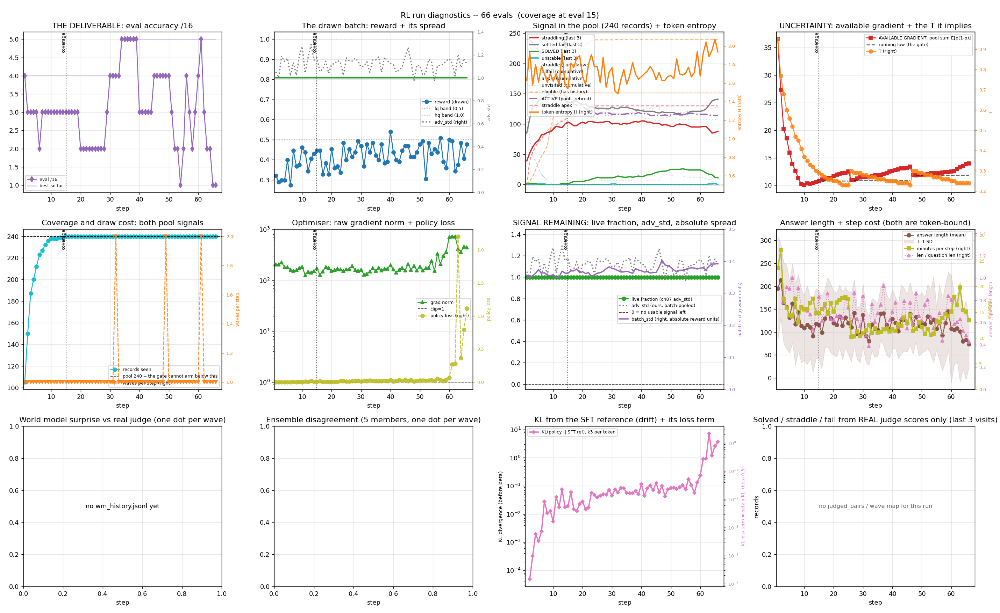
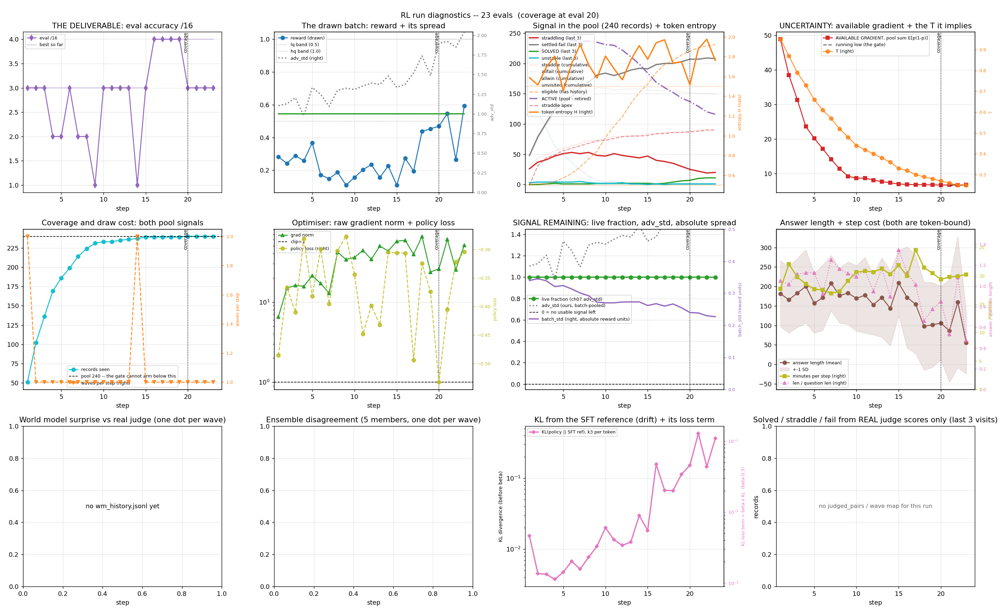

# RL_V2: putting new knowledge into a 0.8B model

**Question.** Can a small model (Qwen3.5-0.8B) hold new domain knowledge (decision trees and ensembles) in its weights, and can reinforcement learning (RL) put it there?

**Answer so far.** Supervised fine-tuning (SFT) puts it there. RL, as built and tested here, did not carry any gain to unseen questions. The RL lane was closed on 2026-09-29.

| Test | Result |
|---|---|
| Full-parameter SFT | base 3 to 7 of 16 at epoch 2; the only phase that raised the eval |
| Continued pre-training (CPT) | no lift |
| LoRA adapter deposits, then RL | lost 0.06 to 0.27 on every route |
| KL penalty (beta) | 0 or 0.001 blew up at step 19; 0.3 held 32 to 60 steps, then ran away |
| Replay of judged answers; world model of the judge | both lost |
| Jev (small yes/no judge) as the reward | exploitable until guarded; rejected 8% of its own golds |
| Transfer to unseen questions | eval 32 to 20 of 128, held-out 79 to 73 of 320: no transfer |

**How to read the 9 of 16.** The 9-slide talk shows base 4, SFT 5, first RL pass 9 (of 16). That is why we had high hopes, and it is the only time RL reached 9. Every later, longer RL run tried to sustain it and never beat it, and eval never rose and held over a run:

| Run | Eval (of 16) | Receipt |
|---|---|---|
| `rl_lr3e6`, 60 steps | start 4, best 5, final 1 | `docs/dispositions.md`, [figure](docs/figures/rl_lr3e6_diagnostics_66evals.png) |
| `rl_replay2`, replay sampler | start 2 (training prompt), best 4, bar 5 missed | `docs/dispositions.md`, [figure](docs/figures/rl_replay2_diagnostics_23evals.png) |
| RL lane overall | closed 2026-09-29, no transfer to unseen questions | table above |

The 9 comes from the early pass, before the replay sampler and the long runs. The 16-question eval wobbles by about 1 with the same seed (6/16 vs 7/16), so a single-eval gain of 1 to 2 does not count as a lift either.

Three readings of the null result remain open: mis-specified but not applied, scale (240 records and a 16-question eval), or the wrong tool (RL sharpens, SFT injects). The scale reading was never tested.

## Start here: one entrypoint, one command per phase

From the repo root, put `src` on the path once (`export PYTHONPATH=src`, or `$env:PYTHONPATH="src"` in PowerShell). Then everything runs as `python -m rlv2 <stage>`. `python -m rlv2 --help` lists the stages. Each stage keeps its own flags (`python -m rlv2 <stage> --help`).

| Phase | Command | Reads | Writes |
|---|---|---|---|
| **1. Dataset generation** | `python -m rlv2 data pull` | RedPajama / SlimPajama, GSM8K | replay corpora |
| | `python -m rlv2 data chunk` | skill notes | `data/cpt_chunks.jsonl` |
| | `python -m rlv2 data entigraph` | skill notes | `data/entigraph/` (relational passages) |
| | `python -m rlv2 data skills-sft` | skill notes | `data/rl/domain_sft.jsonl` |
| | `python -m rlv2 data qa` | chunks | synthetic domain QA |
| | `python -m rlv2 data pools` | chunks | `data/rl/pools_r3.jsonl` (0.80 cosine gate) |
| | `python -m rlv2 data cpt-mix` | chunks, SFT, EntiGraph, replay | CPT corpus |
| | `python -m rlv2 data rl-mix` | pools | RL training mix |
| **2. CPT** (optional) | `python -m rlv2 cpt --full-param --lr 1e-5 --epochs 1 --out harness_runs/cpt` | CPT corpus | CPT checkpoint |
| **3. SFT** | `python -m rlv2 sft --full-param --base harness_runs/cpt --lr 2e-5 --epochs 3 --out harness_runs/sft` | SFT pool, CPT checkpoint | SFT checkpoint |
| **4. RL** | `python -m rlv2 rl --base harness_runs/sft --arms uniform maxent --rounds 2 --out harness_runs/rl` | RL pool, SFT checkpoint | RL adapters |
| **Eval** (any phase) | `python -m rlv2 eval --model <dir> --tag <name>` | frozen 16-question eval | score file |
| **HPO** | `python -m rlv2 hpo sft` / `python -m rlv2 hpo rl` | the phase's pool | Optuna study |

To start at a given phase, point `--base` at the checkpoint of the phase before it (SFT without CPT: `--base` is the stock model). Each stage can be gated by an `hpo` search before its full run. `hpo sft` has no argument parser, so `--help` on it starts a real trial.

## Presentations

Two decks in `docs/`. [`docs/PROVENANCE.md`](docs/PROVENANCE.md) maps each slide to the concept it rests on, the entry in `docs/dispositions.md` that records the result, and the module that implements it. [`docs/INSPIRATIONS.md`](docs/INSPIRATIONS.md) lists every borrowed idea by name. The chess program is in `src/chess/`.

| Deck | Slides | What it is |
|---|---|---|
| [`RL_V2_rl.pptx`](docs/RL_V2_rl.pptx) | 32 | the language-model project: hypotheses, settings, method and verdict per RL idea; slide 30 is why we had high hopes (base 4, SFT 5, first RL pass 9), slides 28 to 29 are the 60-step and replay-sampler plots, slide 31 is what the eval can resolve |
| [`RL_V2_chess.pptx`](docs/RL_V2_chess.pptx) | 4 | the chess agent: what was built, the recipe, the campaign, chess against the language model |

## The RL runs (figures)

Each figure is the run's 12-panel diagnostic: eval accuracy, drawn-batch reward, solved / straddle / fail counts, available gradient, coverage, gradient norm, answer length, KL from the SFT reference. Logs and receipts are in `docs/dispositions.md` and `docs/run-logs/`.

| Run | What it tested | Result | Figure |
|---|---|---|---|
| `rl_lr3e6` | lr 3e-6, KL beta 0.3, 60-step run | stable to step 60, KL runaway at steps 61-63; eval start 4, best 5, final 1 | [66 evals](docs/figures/rl_lr3e6_diagnostics_66evals.png) |
| `rl_replay2` | replay sampler + 2 inner epochs, fresh start | missed its bar (5/16) at step 23, best 4/16; KL abort at step 24 | [23 evals](docs/figures/rl_replay2_diagnostics_23evals.png) |
| three runs compared | which run crossed from straddle to solved | only the crossing run did | [solved / straddle / fail](docs/figures/rl_shapes_solved_straddle_fail.png) |





## Layout

Five folders at the top, five groups in the code:

```
README.md, pyproject.toml
src/chess/         the chess program (self-play agent; see its README.md)
src/rlv2/          the language-model code (python -m rlv2 <stage>)
  common/            length filter, token budgets, cost and VRAM guards, shared training loop, config
  data/              chunking, synthetic questions, similarity-gated pools, CPT and RL mixes
  judge/             judge, reward, answer checks, LLM clients
  train/             cpt/  sft/  rl/  hpo/   the three training stages and the Optuna searches
  eval/              frozen-eval scoring
docs/              presentations, figures, run logs, dispositions.md (every test, with receipts),
                   SETTLED.md (decisions not to re-open), design.md (design), PROVENANCE.md, INSPIRATIONS.md, ast_outline.py
data/              the question pools (below)
configs/           instrument settings
tests/             unit tests
```

## Data

748 questions passed a 0.80 cosine-similarity gate (`data/rl/pools_r3.jsonl`). They are split with no overlap into:

| Set | Rows | File |
|---|---|---|
| Rubric examples | 12 | `r3_rubric.jsonl` |
| Eval, never trained on | 16 | `r3_eval.jsonl`, `r3_eval_canonical.jsonl` |
| CPT | 240 | `r3_cpt.jsonl` |
| SFT | 240 | `r3_sft.jsonl` |
| RL | 240 | `r3_rl.jsonl` (197 train in `r3_rl_train197.jsonl`, 40 held out in `r3_rl_transfer40.jsonl`) |

## Trainers

The RL runs reported above were trained with `grpo_one_file.py`, a single-file GRPO trainer with replay, inner epochs and a KL abort. `src/rlv2/train/rl/grpo.py` is the earlier TRL-based trainer. Slide-by-slide pointers to notes, results and modules are in `docs/PROVENANCE.md`.

## Code outline

Generated from the code by `python docs/ast_outline.py` (checked by `tests/test_ast_outline.py`).

<!-- AST-OUTLINE:BEGIN (generated by docs/ast_outline.py; do not edit) -->

**`src/rlv2/`**

- `__main__.py` (66 lines) the one entrypoint: python -m rlv2 <stage> [stage args].
  - `def main`
  - 1 private helpers

**`src/rlv2/common/`**

- `common/config.py` (67 lines) 
- `common/cost_meter.py` (687 lines) the second ruler: what did this lift COST? (:EfficiencyAccounting:)
  - `class VramCeilingExceeded`: Raised when a stage would cross the hard VRAM wall. Never caught — it must stop the run.
  - `def enforce_vram_ceiling`: Cap the torch allocator to the free window and abort if that is not enough to work in.
  - `def assert_gpu_exclusive`: Refuse to start a GPU stage while ANOTHER training run is alive.
  - `def peak_mib`: Allocator high-water mark in MiB.
  - `class ThroughputCollapsed`: Raised when per-step time breaches the absolute floor. Never caught -- it must stop the run.
  - `def throughput_floor`: A TrainerCallback that kills the run when a single step exceeds a SELF-CALIBRATED time floor.
  - `def current_rung`: The rung this stage should run at, read from disk.
  - `def trip`: Record a VRAM trip and advance the ladder. Returns (next_index, cfg, exhausted).
  - `def is_oom`: True for a real VRAM exhaustion, including our own enforced ceiling.
  - `def run_with_downscale`: Run train_fn(cfg, resume=bool) under the ladder, downscaling on each VRAM trip.
  - `class CostMeter`: Context manager recording wall-clock and peak VRAM for one stage.
  - `def trainable_params`: Parameters that will actually receive gradients. The capacity a method paid for.
  - `def mean_prompt_tokens`: Mean prompt length in tokens — the per-query inference tax (RAG's hidden cost).
  - `def cost_row`: One arm's cost line. Efficiency ratios are suppressed unless the gain is statistically resolved.
  - `def render_cost_table`: Fixed-width cost table. Same column order everywhere so arms are comparable across hypotheses.
  - `def save`: Persist a cost record next to the accuracy JSON. On-disk is primary (repo convention).
  - `def assert_adapter_trained`: Require -- `path` holds a saved PEFT adapter. Guarantee -- raises unless B moved off zero.
  - `def assert_composition`: Require -- `declared` and `actual` map the same ratio names to floats. Guarantee -- raises on
  - `def report_peak_vram`: Emit the ACTUAL peak allocator high-water mark, tagged so log scrapers can find it.
  - 1 private helpers
- `common/lengths.py` (151 lines) log-normal median+2MAD filter, then 4 quantile partitions, to stop paying
  - `def log_mad_band`: Return (lo, hi) token-length band from median +- sigmas*MAD in LOG space.
  - `def filter_outliers`: Split indices into (kept, dropped) by the log-MAD band. DROPS DATA -- report the count.
  - `def quantile_blocks`: Group indices into n_blocks length-alike blocks by quantile. BATCHING ONLY -- drops nothing.
  - `def report`: Print the measured saving. Call before training so the number is on the record, not assumed.
  - 1 private helpers
- `common/loop.py` (191 lines) the training loop CPT and SFT share, as plain PyTorch.
  - `def collate`: Book custom_collate_fn, for records that carry `input_ids`, `attention_mask` and `labels`.
  - `def target_tokens`: Next-token targets that carry loss: labels not equal to -100 AFTER the one-token shift.
  - `def calc_loss_batch`: Book calc_loss_batch: cross entropy of the next token, padding and prompt ignored.
  - `def make_optimizer`: AdamW, 8-bit (`adamw_8bit`) or plain (`adamw_torch`); decay on weights only.
  - `def train_batches`: Train over `batches`: one optimizer step per `grad_accum` batches, for at most `num_steps` steps.
- `common/model_config.py` (84 lines) SINGLE SOURCE OF TRUTH for models + the output-cleanliness CONTRACT (:ModelOutputContract:).
  - `def is_reasoning`
  - `def strip_think`: Remove <think> tags AND their content (residual reasoning bleed).
  - `def assert_clean_text_model`: ENFORCEMENT: a raw reasoning model for FREE TEXT (no schema) bleeds CoT — the contract forbids it.
  - `def clean_generate`: Contract-enforced ollama generation. Free text (schema=None) with a reasoning model RAISES. Always applies
- `common/stratify.py` (305 lines) one joint regime x domain stratification schema, shared by SFT,
  - `def regime_of`: R1/R2/R3/R4 from (context present, answer present).
  - `def is_abstain`
  - `def cell_key`
  - `def cell_counts`
  - `def proportional_allocations`: RAW-proportional allocation: draw_i = round(n * size_i / total), largest-remainder
  - `def stratified_sample`: Draw n records stratified over joint (regime, domain) cells. lam=None -> raw
  - `def allocation_table`: Rows (cell, raw_count, raw_pct, draw_count, draw_pct) for the joint
  - `def print_allocation_table`: Print the joint regime x domain sampling ratios (raw vs drawn). A core,
  - `class Corpus`: Single source of truth: the corpus (data/raw/all.jsonl) + the split manifest +
- `common/token_budget.py` (107 lines) :GenerationBudget: per-(regime x domain) cell max_new_tokens.
  - `def compute`: Fit the per-cell cap from CORPUS gold answers. Returns {"R#|Domain": max_new}.
  - `def load`: Cached per-cell caps; compute+cache on first use.
  - `def cap_for`: Per-cell cap, clamped by the caller's ceiling (gate=low, recall-eval=high).
  - `def filter_truncating`: :TruncationFreeSampling: (data half) — drop any record whose GOLD-answer token count
  - `def batch_completion_cap`: :TruncationFreeSampling: (generation half) — the max_completion_length a batch must use so

**`src/rlv2/judge/`**

- `judge/judge.py` (785 lines) ONE reasoned score per answer, from one local judge.
  - `def load_rubric`
  - `def rubric_sha`: REQ-J9: the rubric is part of the frozen eval. Its hash goes in the receipt so a
  - `def instrument`: Everything needed to reproduce a score. Print this beside any number it produced.
  - `def build_quality_prompt`: CALL 1. The gold is DELIBERATELY ABSENT -- do not add it back.
  - `def build_score_prompt`: THE call. One number, placed against the rubric's scale, with the gold in hand.
  - `def build_verdict_prompt`: CALL 2. Correctness only -- no quality numbers, so the two axes stay independent.
  - `class LatencyBudget`: Adaptive per-call timeout from an EMA of observed latency (owner design, 2026-08-30).
  - `def clamp_to_band`: Keep the judge's score on the correct side of the 0.70 line its verdict implies.
  - `def combine`: Band from the verdict, position within the band from quality.
  - `def parse`: Merge the two responses. FAILS CLOSED to not_attempted / 0.0 / ok=False.
  - `def should_escalate`: True when the reads disagree about which SIDE of the floor an answer is on.
  - `def parse_score`: One number in, verdict DERIVED from it. FAILS CLOSED to score 0.0 / ok=False.
  - `def never_states_an_answer`: True when the response is a plan or preamble that commits to no claim.
  - `def echoes_question`: True when the answer opens with the question's own first `n` words (tasks.md #51).
  - `def judge`: One graded answer, ONE call. Never raises.
  - `def is_correct`: The binary the CPT/SFT gate reads. `not_attempted` is NOT correct -- and it is also
  - 2 private helpers
- `judge/local_llm.py` (73 lines) ollama-backed drop-in for `nvidia_llm.complete`, same signature.
  - `class QuotaExhausted`: Signature parity with nvidia_llm so callers' except-clauses keep working.
  - `def complete`: Return the assistant message content, or raise after RETRIES attempts.
  - `def stats`
- `judge/nvidia_llm.py` (187 lines) shared inference client for NVIDIA's hosted endpoint.
  - `def client`
  - `class QuotaExhausted`: Raised once the breaker opens. A caller that catches this must STOP, not retry.
  - `def complete`: One chat completion. Returns text, or None after MAX_RETRIES (never a partial substitute).
  - `def stats`
  - 4 private helpers
- `judge/reward.py` (1648 lines) Stage 6: Reward function — regime-branched, returns float in [0, 1].
  - `def set_judge_lane`: Select which judge (model + rubric) the training-reward path uses. Loud on purpose.
  - `def verify_verdict`: Programmatic correctness verdict for verifiable domains. True/False/None.
  - `def compose_reward`: verdict True -> floor + weight*quality; False -> 0.0; None -> quality.
  - `def abstention_verdict`: False when the gate is on and an answerable item is abstained on; else None.
  - `def nli_entailment`: Return probability that premise entails hypothesis (0–1).
  - `def nli_entailment_batch`: Batch version — more efficient for semantic entropy computation.
  - `def reward`: Compute reward for a model answer.
  - `def reward_judge`: F1 + WordNet synset/hypernym coverage, scaled by brevity. Fast, no network calls.
  - `def llm_generate_batch`: Free-form generation, batched, on either backend, with THINKING OFF.
  - `def unload_ollama_model`: Unload one Ollama model without stopping the shared server.
  - `def unload_all_ollama_models`: Unload every resident Ollama model before policy training claims the GPU.
  - `def judge_vram_handoff`: Yield exclusive GPU time for the Ollama judge by offloading ALL models to CPU.
  - `def llm_judge_train`: Score one prompt group with the judge and fail on any malformed result.
  - `def judge_pairs`: Order-aligned scores. Never fabricates. Recursive split breaks the temp=0 glitch;
  - `def llm_judge_flat`
  - `def judge_concurrency`: How many judge calls may be in flight. Depends on WHICH judge is live.
  - `def llm_judge_flat_many`: Score multiple INDEPENDENT pair-chunks with up to `max_workers` Ollama
  - `def llm_judge_batch_train`: Score all prompt groups using flat pair format. Raises on count mismatch.
  - `def llm_judge_eval`: Score all eval classes in one structured call. Returns {cls: score}, {} on failure.
  - 39 private helpers
- `judge/verifiers.py` (522 lines) 
  - `def verify_math`: Programmatic correctness check for math answers.
  - `def score_premises`: Fraction of keyed triplets the answer asserts, in the keyed order.
  - `def verify_entailment`: Does `answer` entail the gold's claims? None when no claim is extractable.
  - `def verify_code`: Run the candidate against the record's asserts. True / False / None.
  - `def code_simplicity`: 1.0 when the candidate is no bigger than the reference, decaying after.
  - `def score_code`: Correctness gate, then simplicity as a tie-breaker. None = not keyable.
  - `def math_conciseness`: 1.0 when the answer is no longer than the reference solution, decaying after.
  - `def score_math`: Correctness gate, then conciseness as a tie-breaker. None = not keyable.
  - `def score_rlvr`: The reward: 0.0-1.0 from a verifiable check, or None to use the judge.
  - `def verify_short_answer`: Short-answer exact match for STEM. True / False / None.
  - `def rlvr_score`: Tiered verifiable reward. Returns (verdict, method).
  - 9 private helpers

**`src/rlv2/data/`**

- `data/chunking.py` (292 lines) build the CPT corpus: skill notes -> canonical atoms -> packed 512-tok records.
  - `def find_overlap`: Longest suffix of s1 that matches a prefix of s2.
  - `def de_overlap_strings`: Remove overlapping suffixes from consecutive strings. Concatenation reconstructs the source
  - `def self_test`
  - `def mad`
  - `def q`
  - `def sections`: [paragraphs] per section; zero-paragraph sections DROPPED (bare headers carry no content and
  - `def atoms_for`: Canonical units that TILE the source: merge sections below m paragraphs, split above m+2d with
  - `def pack`: Greedy accumulation to `budget` tokens, window stepping by `stride` units.
  - `def main`
- `data/cpt_mix.py` (396 lines) assemble the CPT corpus for the R3 experiment.
  - `def token_len`
  - `def split_to_cap`: Split an over-cap SKILL on paragraph boundaries until every piece fits.
  - `def boxcox_length_band`: (lo, hi) token band from median +- sigmas*MAD*1.4826 in BOX-COX space.
  - `def load`
  - `def render_ntp`
  - `def entigraph_for_skills`: Passages relating two of OUR skills, by metadata or by mention.
  - `def main`
- `data/entigraph.py` (275 lines) EntiGraph over the skills corpus, where the entities are already named.
  - `def load_skills`
  - `def sample_relations`: Within-topic pairs, then triples. Cross-topic relations are mostly vacuous filler.
  - `def main`
  - 3 private helpers
- `data/index_chroma.py` (91 lines) Stage 4: Build a ChromaDB vector index over the labeled corpus.
  - `def get_collection`
  - `def build_index`
  - `def query_similar`: Return up to k metadata dicts ranked by cosine similarity.
  - 1 private helpers
- `data/label_regimes.py` (113 lines) Stage 3: Regime Labeling
  - `def label_regime`: Assign regime to a single record.
  - `def label_file`
  - 2 private helpers
- `data/pools.py` (1881 lines) §6.11 R3-only three-pool generation over the 3 trees-ensembles skills.
  - `def category_pdf`: Box-Cox(lam) of CATEGORY_AVG_WEIGHTS, renormalised. THE allocation basis.
  - `def category_quota`: How many items of each category an n-item pool should hold. Largest remainder.
  - `def resolved_gen_model`: The model that actually generated an item.
  - `def num_predict_for`: Output-token budget for a batch of `batch_n` items.
  - `def gate_reason`: Content-rejection reason for one candidate, or None to accept.
  - `def to_ascii_math`: Rewrite LaTeX / unicode math as ASCII pseudo-code.
  - `class RemoteMiss`: The endpoint returned NOTHING -- distinct from 'the model wrote something unusable'.
  - `def batch_schema`: Strict schema for one batched ask (REQ-G3/G4/G5).
  - `def dedupe_by_fact`: Drop ITEMS that reuse a fact_index. Never drop the batch (REQ-G5).
  - `def embed`
  - `def load_chunks`
  - `def allocate`: Proportional to chunk content, summing EXACTLY to `total`.
  - `def allocate_by_skill`: Split `total` EQUALLY across skills, then across each skill's chunks.
  - `def plan_tasks`: Interleaved A/B work list: [(chunk, pool), ...].
  - `def style_exemplars`: Few-shot exemplars drawn from the real VibeThinker R3 eval, shaped to R3's profile.
  - `def style_exemplars_by_category`: Few-shot exemplars MATCHED to the category being asked for.
  - `def parse_batch`: Pull a LIST of {question, answer} out of model text, tolerantly.
  - `def strip_reasoning`: Remove <think>...</think> traces before any JSON extraction.
  - `def parse_json`
  - `def central_chunks_per_skill`: Pick the most representative chunk for each skill.
  - `def main`
  - 7 private helpers
- `data/pull_datasets.py` (410 lines) 
  - `def sample_from_shards`: Fetch the minimum number of Parquet shards needed to collect n rows.
  - `def normalize_row`: Map a raw row to {question, context, answer}. Return None to skip.
  - `def sample_oasst1`: oasst1 is a message tree; join prompter→assistant pairs before sampling.
  - `def calculate_allocations`: Allocate target_total records across datasets using a two-parameter
  - `def main`
- `data/rl_mix.py` (137 lines) assemble the MGPO training mix: staged RL corpus + data-science skills + abstention.
  - `def main`
  - 1 private helpers
- `data/skills_sft.py` (350 lines) synthetic SFT QA from the stackskills corpus. Stage 1 of the full regimen.
  - `def select`: Stratified by topic, proportional. Keeps every topic represented rather than dropping some.
  - `def split`: Split by SKILL, never by QA pair -- see the module docstring on leakage.
  - `def split_preserving`: Re-derive TRAIN/EVAL from RAW against a PINNED held-out skill list.
  - `def regen_truncated`: Rebuild QA for skills whose source exceeded the OLD generation limit, IN PLACE.
  - `def main`
  - 4 private helpers
- `data/synthetic_qa.py` (260 lines) Stage 5: Synthetic QA generation with regime re-labeling.
  - `def generate_for_seed`: Generate PAIRS_PER_SEED × len(SAMPLER_CONFIGS) synthetic records for one seed.
  - `def main`
  - 6 private helpers

**`src/rlv2/train/cpt/`**

- `train/cpt/train.py` (867 lines) Continued Pretraining with gradual annealing and Box-Cox stratified corpus sampling.
  - `def load_text_corpus`: Load a text file as a single string for chunking.
  - `def load_jsonl_texts`: Load texts from a JSONL file (one JSON object per line with a text field).
  - `def chunk_text`: Tokenize text and split into non-overlapping chunks of chunk_size tokens.
  - `def pack_atoms`: Pack whole records into sequences of at most `budget` tokens, never splitting one.
  - `def derive_token_budget`: Tokens per batch that the cross-entropy logits can afford, from MEASURED VRAM.
  - `def derive_batch_size`: Largest per-device batch whose LOGITS still fit in measured free VRAM.
  - `def build_corpus`: Build the CPT corpus: per-source chunks for Box-Cox allocation.
  - `def allocate_chunks`: Box-Cox stratified allocation across sources.
  - `def sample_epoch`: Sample one epoch's training data with annealing between general and domain.
  - `def main`

**`src/rlv2/train/sft/`**

- `train/sft/loop.py` (25 lines) one SFT epoch over pre-packed bins, on the shared training loop.
  - `def train_bins`: Train one epoch: one optimizer step per bin, schedule spanning all bins.
- `train/sft/manifold_sampler.py` (375 lines) Copula manifold sampler with delta-ratio correction and token-budget bin packing.
  - `class ManifoldSampler`: Copula manifold sampler with cumulative delta-ratio correction.
  - `def stratified_eval_split`: Split eval set into n stratified groups, each with ≥1 record per populated cell.
- `train/sft/train.py` (877 lines) SFT on a Box-Cox class-balanced VibeThinker subset. The stage RL needs in front of it.
  - `def build_subset`: Two-axis MMR cross-hatch draw over answer_type x dataset grid.
  - `def fmt`: Prompt exactly as the eval builds it, so SFT teaches the format it is scored on.
  - `def main`
  - 4 private helpers

**`src/rlv2/train/rl/`**

- `train/rl/differentiability_ledger.py` (237 lines) Persist what the replay buffer learns per record, keyed by phase state.
  - `def phase_state`: sha1 of the weights' identity -- content, not path (REQ-L2).
  - `def key`
  - `def load`: Rows for exactly this key, or {} -- never another context's (REQ-L2).
  - `def save`: ONE write, at the end (REQ-L5). Merges into the same key (REQ-L4).
  - `def as_history`: Ledger rows -> the `history` shape grpo_one_file.visit_stats consumes.
  - `def as_last_visit`: Ledger rows -> {question: rewards from the MOST RECENT visit only}.
  - `def prior_history`: THE ONE WAY A TRAINER GETS ITS PRIOR. Call this; do not hand-roll load+as_history.
  - 2 private helpers
- `train/rl/dpo_pass.py` (139 lines) IPO on judge preference pairs from the harvest sidecars.
  - `def load_jsonl`
  - `def build_pairs`: chosen >= floor > rejected, per question. Chosen mirrors harvest_sft's
  - `def main`
- `train/rl/entity_validity.py` (192 lines) un-gameable, deterministic "context-entity-precision" correctness signal.
  - `def key_entities`: Tiered key-entities of a text: proper-noun phrases, numbers, and salient content tokens.
  - `def entity_recall`
  - `def entity_precision`: Of the answer's ASSERTED entities (proper nouns + numbers), the fraction grounded in gold+context.
  - `def succinctness`: 1.0 while the answer is no longer than the needed length (max(gold_len, floor)); decays for padding.
  - `def entity_validity`: Drop-in un-gameable correctness in [0,1]. Math delegates to the programmatic verifier.
  - `def classify_answer`: Trichotomy over one answer: correct / neighbor-conflated / hallucinated (Gekhman arXiv:2405.05904).
  - `def trichotomy`: Bucket counts + rates over a batch. `siblings` defaults to the golds themselves (leave-one-out),
  - 4 private helpers
- `train/rl/exploit_finder.py` (86 lines) find REAL judge exploits: completions the judge scored HIGH but that are
  - `def correctness`: Un-gameable: does the answer actually convey the gold fact? For Math, programmatic verify;
  - `def main`
  - 2 private helpers
- `train/rl/grpo.py` (2589 lines) VibeThinker's Signal phase (arXiv:2511.06221), two-armed so the mechanism is falsifiable.
  - `class TrainingHealthMonitor`: Enforce the observable-MGPO runtime contract.
  - `def assert_partition_disjoint`: Reject train overlap with every eval and rubric partition before model loading.
  - `def make_reward`: Return the sole MGPO reward path: isolated LLM-judge scores, lane-shaped.
  - `def bootstrap_cohort`: Hierarchical cross-hatch sampling with Box-Cox at each level.
  - `def continuation_probabilities`: Return explicit round-two draw probabilities for the matched control or MGPO arm.
  - `def select_continuation`: Draw round-two prompts with replacement from the fixed bootstrap cohort.
  - `def per_continuation`: PER-style round-2 curriculum: soft priorities + fresh injection (E8).
  - `def coverage_first_cohort`: Operator's curriculum rule (2026-09-07): VISIT COUNT DOMINATES.
  - `def dyna_ipo_step`: Task #44 — Dyna-MGPO's offline update, run at each round boundary.
  - `def probe_disagreement_cohort`: Two-model epistemic cohort selection + visit-count bonus (E1+E2).
  - `def run_arm`
  - `def main`
  - 8 private helpers
- `train/rl/harvest_sft.py` (193 lines) harvest a checkpoint's SAMPLED successes into an SFT dataset.
  - `def load_jsonl`
  - `def qtext`
  - `def assert_no_eval_leakage`: Tripwire (fails closed): harvesting an eval question would fine-tune on the
  - `def select_best`: Best CORRECT completion for one question: highest judge score wins; ties go
  - `def to_sft_row`: Deposit-schema row (matches data/rl/sft_r3_deposit_half.jsonl, the format
  - `def main`
  - 2 private helpers
- `train/rl/instrument.py` (160 lines) The frozen instrument, verified at startup and stamped into every receipt.
  - `def load`
  - `def observed`: What the instrument ACTUALLY is right now, read from the live system.
  - `def diff`: Every way the live instrument departs from the pinned one. Empty = clean.
  - `def verify`: Raise unless the live instrument matches the pinned one. Call before scoring.
  - `def stamp`: The block every receipt carries, so a number can never be orphaned from the
  - 2 private helpers
- `train/rl/prompt_world_model.py` (335 lines) ensemble world model of the prompt->judge environment.
  - `def build_labels`: Harvest (prompt, w, l) rows from the visit ledger and the labeling sweep.
  - `def train_ensemble`: K heads, each on a bootstrap resample (the Dyna-Q EnsembleWorldModel).
  - `def load_ensemble`
  - `def predict`: (p_mean, p_var) per row. p_var is MODEL DISAGREEMENT — part 6: 'best read as
  - `def validate`: The two gates that must PASS before any selection use (part 6: model loss is
  - `def build_qa_labels`: Join each harvest's .gen.jsonl (answer texts) with its .scored.jsonl
  - `def train_qa_ensemble`: Same bootstrap-resampled heads as train_ensemble; target is the judge's
  - `def qa_auc`: Held-out discrimination: does the verifier rank judge-correct answers
  - `def qa_rerank`: Offline pick: for each frozen-eval question, the verifier chooses among the
  - `def main`
  - 4 private helpers
- `train/rl/red_queen_validity.py` (126 lines) UN-GAMEABLE validity metric for the Red Queen loop.
  - `def measure_validity`: Greedy completions on the holdout, scored programmatically (no judge).
  - 1 private helpers

**`src/rlv2/train/hpo/`**

- `train/hpo/rl.py` (221 lines) Three-trial LoRA MGPO learning-rate search on the matched two-round schema.
  - `def objective`: Train one 2×9 regime-balanced LoRA MGPO trial and return canonical mini-eval macroF1.
  - `def main`
  - 1 private helpers
- `train/hpo/sft.py` (110 lines) Optuna TPE sweep over full-param SFT to find the config that learns abstention.
  - `def objective`
  - `def main`

**`src/rlv2/train/`**


**`src/rlv2/eval/`**

- `eval/cpt_fewshot_lift.py` (137 lines) fast isolated CPT knowledge-injection lift, few-shot closed-book (NO re-CPT, NO SFT).
  - `def smoke`: 5-question base+few-shot format check: does the 0.8B answer (not ramble/abstain)?
  - `def main`
  - `def test2`: Rung 2 — + domain-QA SFT (activate latent CPT knowledge). Reuses existing SFT adapters (on disk).
  - 3 private helpers
- `eval/half_epoch_eval.py` (565 lines) F1 on the frozen eval at every half-epoch, in EVERY phase.
  - `def load_eval`
  - `def strip_reasoning`: Remove <think>...</think> traces before the judge sees the answer.
  - `def chat_wrap`: Build the prompt EXACTLY as training wrote it. Think is OFF everywhere.
  - `def banned_ids`: Token ids no phase may ever generate: reasoning blocks and tool calls.
  - `def generate`: Completions from the LIVE model.
  - `def evaluate`: Generate, score, print. Returns the summary, or None if anything went wrong.
  - `class HalfEpochEval`: Fires at every half-epoch boundary, plus once at the end.
  - `def load_policy`: Load a full-param checkpoint or a base+adapter pair.
  - `def main`
  - 2 private helpers
- `eval/policy_eval.py` (208 lines) Shared multi-sample generation and scoring.
  - `def fmt_prompt`
  - `def generate_greedy_batch`: Greedy generation over many prompts, batched. Greedy is deterministic, so batching is
  - `def load_adapter`: Load base model + adapter. Returns (model, tokenizer). Caller must del + empty_cache when done.
  - `def multi_sample_score`: For each record generate one completion per sampler config, then score all with judge.
  - 3 private helpers
- `eval/rl_calibration_eval.py` (733 lines) score RL on the reward it was DESIGNED against: the R1-R4 crosshatch.
  - `def looks_abstain_broad`
  - `def abstain_messages`: Few-shot prompt that PERMITS declining. The default harness forbids it.
  - `def derive_regime`: Regime from (context present, gold present). `rl_eval` carries neither a `regime` field nor a
  - `def verify_scorer`: Assert `reward.reward` responds in BOTH directions before any arm is trusted.
  - `def evaluate`: Evaluate one aligned generation per row and persist complete diagnostics.
  - `def load_model`
  - `def main`: Run one scorer invocation and persist/print its complete diagnostic chain.
  - 3 private helpers
- `eval/score_arms.py` (599 lines) score EVERY arm in ONE invocation, so the instrument cannot drift.
  - `def generate_all`: {arm: [k lists of Q answers]}. One model resident at a time (tech.md: never co-reside).
  - `def score_question`: ONE call ranking every arm's answer to ONE question.
  - `def auc`: P(random correct answer scores above a random wrong one). The MONOTONE separation measure.
  - `def kl_divergence`: KL(correct || incorrect) over binned scores. Laplace-smoothed so an empty bin stays finite.
  - `def bootstrap_ci`: Percentile CI on a proportion. A point estimate at n=16 carries no claim on its own.
  - `def main`
  - 2 private helpers
- `eval/score_r3_categories.py` (174 lines) the R3 objective readout, per CATEGORY, at k samples.
  - `def is_correct`: Did this sample answer the question? The VERDICT decides when there is one.
  - `def load`
  - `def summarise`: records: one row per (item, sample) with keys item_id, category, reward.
  - `def render`: The §6.10 grid, on the axis that carries information.
  - `def main`

<!-- AST-OUTLINE:END -->
